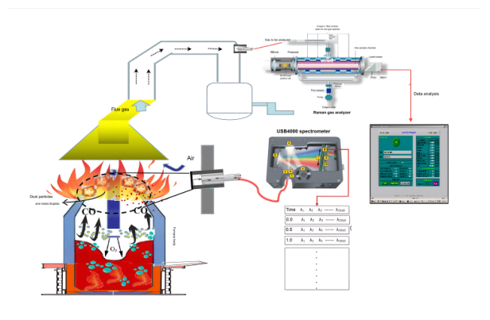
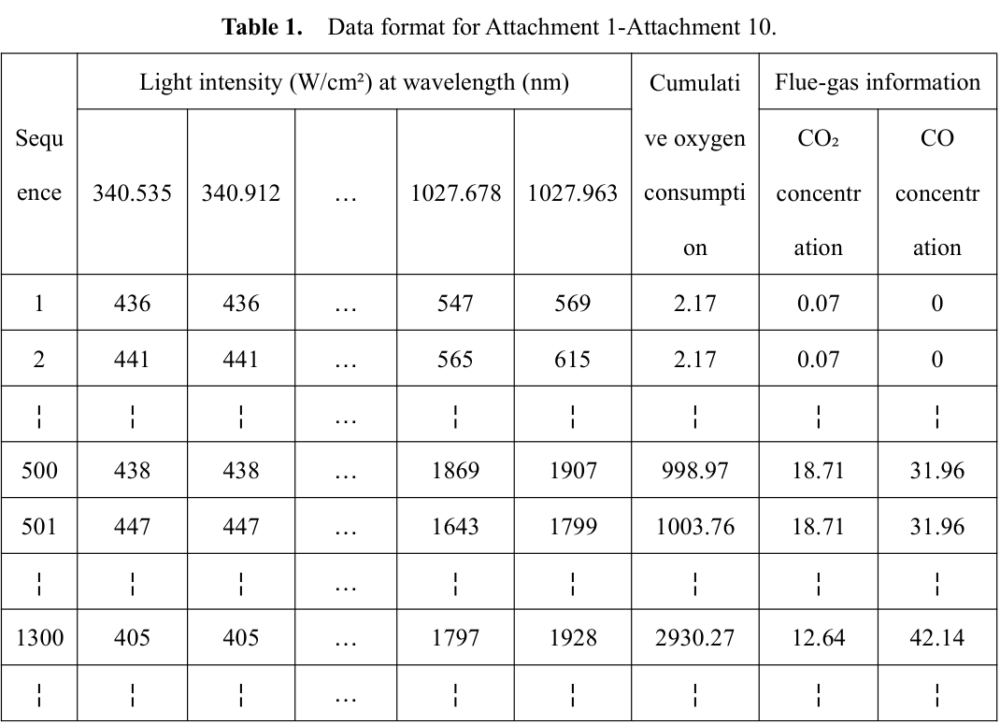

# 2026 亚太杯数学建模 B 题团队分工

## 题目导读

B 题研究**转炉炼钢中的双模态时序融合**。吹氧过程中，炉口光谱仪可以实时观察火焰变化，烟气分析仪则要等烟气经过管道后才能测到 CO 和 CO₂。题目的核心是利用炉口的实时光谱，提前预测烟气分析仪稍后才能测到的信息。

*设备布局截自官方 B 题第 2 页图 1。*

官方提供 **10 个真实炼钢炉次**，每炉约 **1400 个采样时刻**，相邻时刻间隔 **0.5 秒**。每行包含采样序号、**2047 个波长点的火焰光谱强度**、累积耗氧量和两种烟气的测量值。题表将烟气列标为 `concentration`，正文说明数值表示 **CO₂ 和 CO 的瞬时体积流量**，单位为 `m³/s`。累积耗氧量的单位为 `m³`。

*附件数据格式截自官方 B 题第 3 页表 1。*

| 问题 | 要解决什么 | 如何接到第三问 |
| --- | --- | --- |
| 第一问 | 对光谱去异常并在时间、波长两维连续重建，绘制 10 炉三维光谱图 | 提供光谱质量诊断、预处理方法和候选特征 |
| 第二问 | 重建耗氧和烟气信号，估计不同氧枪流量下的烟气时延 | 提供时延模型和光谱与烟气的时间对齐依据 |
| 第三问 | 用实时光谱预测 CO、CO₂，整体或分组融合各炉模型，并在全部 10 炉上验证 | 将前两问成果接入预测，检验提前预测和跨炉泛化能力 |

[官方 B 题原文](problem/2026%20APMCM%20Problem%20B/2026%20APMCM%20Problem%20B.pdf)

# 分工总览

## 问题定义：我们要解决什么问题？不止题干！ 

我们按 **一位总体建模负责人、两位独立模块负责人**推进。队员 A 负责第一问的光谱数据与连续重建，队员 B 负责第二问的过程信号与动态时延，总体负责人负责第三问和全文整合。三位负责人各自推进所负责部分的假设、实验、图表与写作。

| 角色   | 负责范围            | 主要交付                            |
| ---- | --------------- | ------------------------------- |
| 我    | 第三问、统一建模框架与全文统稿 | 实时预测代码、消融结果、跨炉融合与验证、第三问初稿、论文整合稿 |
| 队员 A | 第一问、光谱数据研究与连续重建 | 数据质量小结、去异常与重建代码、10 炉三维光谱图、第一问初稿 |
| 队员 B | 第二问、炼钢机理与动态时延   | 机理与文献小结、连续过程曲线、流量–时延模型、第二问初稿    |

## 队员 A · 光谱数据与连续重建

1. 检查全部 10 炉的表结构、时间与波长坐标、缺失值和异常值。区分单点尖刺、成段异常和可能的真实谱峰，给出典型样例及分布统计。
2. 给出波段相关性、奇异值谱和累计解释方差，比较不同炉次的光谱分布。总结哪些==波段或特征可供第三问尝试==，以及它们是否跨炉稳定。
3. 选取合理的去异常方法做对照，用局部谱形和可量化的误差检查修复效果。项目已有第 1 炉鲁棒低秩分解试跑，可用作对照。最终方法由数据与实验决定。
4. 建立连续光谱模型 $S(t,\lambda)$，完成 **10 炉三维光谱图**，提交数学公式、可复现代码、异常掩码、重建结果及第一问初稿。

**交给第三问**的内容包括按时间排列的光谱、波长坐标、异常掩码，以及可复用的变换和可选低维特征。说明整炉离线重建用了哪些时间点，并给出实时预测可以使用的处理方案。

### 方向建议

- **先用简单方法建立对照。** 对每个波长的时间序列或每帧光谱做局部 Hampel 检测，用滑动中位数和 MAD（中位数绝对偏差）识别尖刺。对候选点同时查看相邻时刻和相邻波长，判断它是单点跳变还是连贯的谱峰变化。
- **尝试鲁棒 PCA。** 将每炉的光谱矩阵分为低秩主体、稀疏偏差和小幅噪声。第 1 炉试跑中，允许小幅噪声的版本得到秩为 11 的中心化主体，但仍会把部分跨多个波长的谱峰变化分到稀疏项。可以把稀疏项用于标记候选，再对有局部证据的点用低秩估计值或邻域插值修复。
- **用两类证据选方法。** 在原始光谱的代表性片段上人工注入不同幅度的尖刺，比较识别率和修复误差。同时抽查真实谱峰，比较处理前后的峰高、峰位和峰形。去异常后可从时间 × 波长的二维样条插值起步，检查重建曲面在窄峰附近是否出现过冲。

## 队员 B · 过程信号与动态时延

1. 调研转炉炼钢、炉口光谱与烟气的联系，以及采样管路和分析仪如何产生时延。==记录关键证据与参考文献。==
2. 去异常并重建累积耗氧量和 CO、CO₂ 瞬时体积流量。对前者求导得到氧枪流量，对后两者积分得到累计排放量。绘制六类过程曲线，分析累积耗氧量与两种烟气的瞬时流量及累计排放量的关系。
3. 估计不同氧枪流量下的时延，拟合满足**流量越大、时延越小**的模型。报告各流量区间的数据支持、估计误差或不确定性，以及模型适用的流量范围。
4. 用数据回答以下问题，提交流量–时延图、模型公式、可调用代码及第二问初稿。

   - CO 与 CO₂ 的有效时延是否需要分别估计？
   - 氧枪流量能解释多少时延变化？不同炉次能否共用同一规律？
   - 现有数据能否区分化学反应延迟与烟气运输延迟？纯时延近似是否足够？

**交给第三问**的内容包括连续过程信号、可调用的时延函数或插值表、时延单位、拟合参数和不确定性。明确时延对应炉口事件时刻还是分析仪观测时刻，并提供一个对齐样例。

### 方向建议

- **先重建累积量，再求导。** 对累积耗氧量先去异常，再比较带单调约束的平滑或保形插值。从连续曲线求氧枪流量，重点检查平台段和启停段。CO、CO₂ 可分别重建为非负流量曲线，再对时间积分得到累计排放量。
- **用局部互相关估计候选时延。** 在氧枪流量有明显变化的窗口内，对去趋势后的流量和两路烟气信号分别搜索正时延，记录每个窗口的代表流量、相关峰位置和峰的清晰程度。给变化不足或相关峰不明确的窗口做质量标记，再比较各流量区间的时延和数据量。
- **比较固定时延与单调动态时延。** 从固定时延基线起步，再尝试单调回归或 $\tau(u)=a/(u+b)+c$，其中 $a,b>0$、$c\ge 0$。用留出炉次比较对齐效果，检查 CO、CO₂ 能否共用参数，以及动态模型的改进是否稳定。由氧枪到烟气信号估到的量先解释为**有效时延**，其中可能包含反应、输运和仪器响应。

## 我 · 实时预测与全文整合

1. 确定预测目标、时刻定义和可用输入。先用原始光谱、简单预处理和临时固定提前量建立基线，让第三问从第一天开始推进。
2. 在相同提前量、时间点和验证炉次上比较单帧光谱、简单历史窗口和轻量 Temporal Attention。先看历史信息有没有增益，再看注意力是否优于简单窗口。
3. 接入第一问的光谱处理和第二问的动态时延，检验对齐及历史建模各自的贡献。整篇论文把炉内过程的时间依赖与烟气测量时延分别定义清楚。
4. 对不同炉次训练得到的模型做整体或分组融合，采用**逐炉留一**覆盖全部 10 炉，分别报告 CO、CO₂ 的逐炉结果。归一化、降维、时延参数和融合权重等数据驱动步骤在每折用训练炉拟合，实时输入只使用预测时刻已经可获得的数据。
5. 完成第三问初稿，统筹三问的术语、公式、图表、创新点和结论，审核并整合全文。

## 模块对接

| 提供方 | 接口草案 | 第一版需要约定 |
| --- | --- | --- |
| 队员 A | `preprocess(X)` → 清理后的光谱、异常掩码、可选低维特征 | 约定矩阵为时间 × 波长。保留原采样索引。区分离线重建与实时可用变换 |
| 队员 B | `estimate_delay(u)` → CO、CO₂ 的时延及可提供的不确定性 | 时延以秒计。给出时间基准、对齐方向、适用流量范围和边界处理 |
| 总体负责人 | `predict(X, u)` → 带目标时刻的 CO、CO₂ 预测 | 明确光谱和氧枪流量在预测时刻的可用性。光谱作为基线输入，流量按实验设置接入 |

共用附件序号和原始炉号标识数据，采样间隔按 **0.5 秒**处理。第一天用同一炉跑通读取和时间索引，各方先共享一个最小样例。原始附件保存在 `problem/`，处理后的数据放 `data/`，代码放 `src/`，图表和实验结果放 `results/`，分问初稿放 `paper/`。随结果记录运行命令、环境和关键参数。

## 四天安排

| 时间 | 总体建模负责人 | 队员 A | 队员 B |
| --- | --- | --- | --- |
| 第 1 天 | 定义目标、跑通基线与逐炉数据切分 | 检查 10 炉数据，给出异常和低秩分析样例 | 梳理机理，检查过程信号与可用于估计时延的变化 |
| 第 2 天 | 对照单帧、历史窗口和 Temporal Attention | 比较去异常方法，完成连续重建初版 | 完成连续信号与时延函数初版，提供对齐样例 |
| 第 3 天 | 接入两模块，完成跨炉融合与验证 | 完成 10 炉三维图，复查谱峰保留情况 | 验证跨炉时延规律，整理误差和不确定性 |
| 第 4 天 | 整合全文，复查证据、格式和提交材料 | 交第一问初稿、最终图和复现说明 | 交第二问初稿、最终图和复现说明 |

每天集中同步一次，每人带来**一项关键发现、当前可交接的产物、需要对齐的接口或待决问题**。会后更新各模块的交付时间。

如果需要按队友的技术背景调整工作量，A 优先完成光谱数据诊断、图表和第一问写作，B 优先完成机理调研、信号与时延分析及第二问写作。总体负责人可协助关键算法实现，各模块负责人继续负责结果判断和本问交付。
